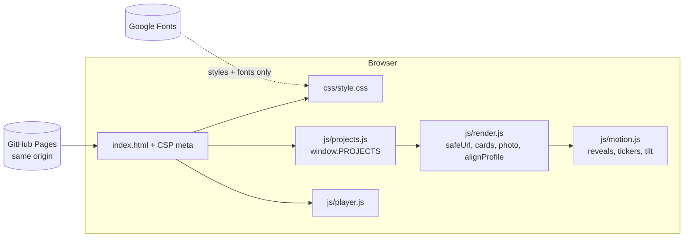

# ARCHITECTURE

Last verified: working tree on top of commit `2dbda4a`, 2026-11-16. Labels: VERIFIED (checked by command or browser run) / INFERENCE / UNKNOWN.

## Components and data flow

## Trust boundaries
- Same origin (`bigg-whale.github.io`): all scripts, styles, images, audio. Trusted.
- Google Fonts: the only third party. Limited by the CSP to stylesheets and font files.
- `window.PROJECTS`: author-controlled data, still treated as untrusted when rendered (text via `textContent`, URLs via `safeUrl`).
- No inbound data: the code reads nothing from the URL, storage, cookies or the network.

## Data contract: `window.PROJECTS` (array, in `js/projects.js`)
| Field | Type | Semantics |
|---|---|---|
| `num` | string, optional | small label above the title |
| `title` | string | defaults to "Untitled" |
| `hook`, `blurb`, `role` | string, optional | text paragraphs |
| `images` | string[] | relative paths or http(s) URLs; unsafe entries dropped; `[]` shows a placeholder. Outside hosts are blocked by the CSP |
| `video` | string | if set, replaces the image strip; first image becomes the poster |
| `bullets`, `tags` | string[] | lists |
| `links` | object | key → URL; `itch` and `github` have labels, other keys use the key as label; empty or unsafe URLs render nothing |
| `featured` | boolean | `true` = large two-box layout; others go in the grid |

Postconditions of `render.js`: one `<article>` per project inside `#projects`; `#games-title` and `[data-count="projects"]` follow the list length; `safeUrl` returns `""` or an absolute `http:`/`https:` URL (`file:` only when the page is on `file:`).

## motion.js behaviour
Exits early, leaving the static page, when `prefers-reduced-motion: reduce` is set or `IntersectionObserver` / `requestAnimationFrame` is missing. Otherwise adds `html.js-motion`, then `html.hero-in` after two frames. Scroll reveals use one `IntersectionObserver` and unobserve after firing. Tickers are driven by a single rAF loop, and skip work when off-screen. Tilt is fine-pointer only.

## Non-functional notes
- No state, so no consistency model.
- Accessibility: split headings carry an `aria-label` with the full text (a ` ` counts as a space); decorative strips are `aria-hidden`.
- Page weight: about 0.3 MB of images; the 0.96 MB audio loads only on play (`preload="none"`).
