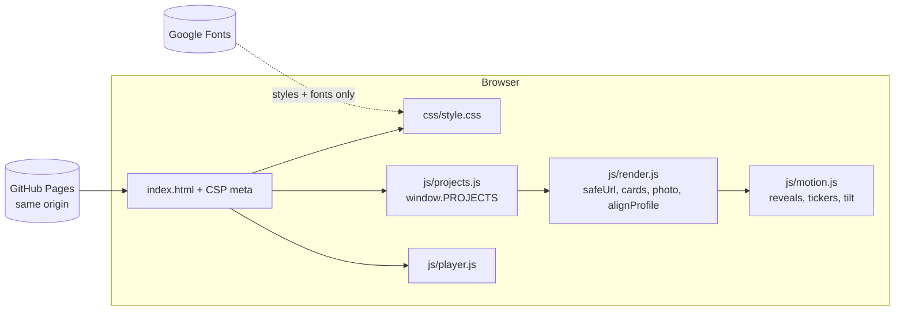

# ARCHITECTURE

Last verified: working tree on branch `sinos-play` on top of commit `2dbda4a`, 2026-11-17 (uncommitted). Labels: VERIFIED (checked by command or browser run) / INFERENCE / UNKNOWN.

## Components and data flow


## Play page (`sinos/`)
A separate document, not rendered by `render.js`. The homepage links to it with a plain relative link (`links.play`).

```mermaid
flowchart LR
  H[index.html "Just shipped" SinOS card] -->|link sinos/| S[sinos/index.html + CSP meta]
  S --> PJ[play.js]
  PJ -->|new V86 config| V[v86/libv86.js]
  V -->|compiles| W[v86/v86.wasm]
  V -->|fetch| B[seabios.bin, vgabios.bin]
  V -->|fetch whole file| I[sinos.img: boot disk]
  V -->|HTTP Range requests| D[data.img: FAT16 data disk]
  V -->|helper worker from blob: URL| WK[Worker]
  V --> SC[div.screen: text mode via innerHTML, canvas for mode 13h]
```

Data flow: the user clicks "Boot SinOS" (no autoboot) -> `play.js` constructs the emulator with BIOS, VGA BIOS, `sinos.img` as primary disk and `data.img` as second disk (asynchronous, range-fetched) -> v86 runs the guest CPU in WebAssembly -> guest text output is written to the screen container, VGA mode 13h output to the canvas -> keyboard events are captured while the screen element has focus (arrow keys are prevented from scrolling the page). Disk writes made by the guest are kept in memory only and vanish on reload or Restart.

## Trust boundaries
- Same origin (`bigg-whale.github.io`): all scripts, styles, images, audio. Trusted.
- `sinos/v86/*`: third-party code (BSD-2-Clause emulator, LGPL-3.0 BIOS) self-hosted on the same origin, so `script-src 'self'` trusts it fully. It runs only on `/sinos/`, whose CSP is relaxed (see `docs/SECURITY.md`, `docs/adr/0002-sinos-in-browser-via-v86.md`). Guest code (SinOS) is sandboxed inside the emulator and has no network device configured. VERIFIED by reading `play.js`: no network relay or NIC option is configured.
- Google Fonts: the only external third party. Limited by the CSP to stylesheets and font files.
- `window.PROJECTS`: author-controlled data, still treated as untrusted when rendered (text via `textContent`, URLs via `safeUrl`).
- No inbound data: the code reads nothing from the URL, storage, cookies or the network.

## Data contract: `window.PROJECTS` (array, in `js/projects.js`)
| Field | Type | Semantics |
|---|---|---|
| `num` | string, optional | small label above the title |
| `title` | string | defaults to "Untitled" |
| `hook`, `blurb`, `role` | string, optional | text paragraphs |
| `images` | string[] | relative paths or http(s) URLs; unsafe entries dropped; `[]` shows a placeholder. Outside hosts are blocked by the CSP |
| `video` | string | if set, replaces the image strip; first image becomes the poster |
| `bullets`, `tags` | string[] | lists |
| `links` | object | key → URL; `play` ("Play in browser", local relative path such as `sinos/`), `itch` and `github` have labels, other keys use the key as label; empty or unsafe URLs render nothing |
| `featured` | boolean | `true` = large two-box layout; others go in the grid |

Postconditions of `render.js`: one `<article>` per project inside `#projects`; `#games-title` ("The games" when more than one project) and `[data-count="projects"]` (plus its label, plural when not 1) follow the list length; `safeUrl` returns `""` or an absolute `http:`/`https:` URL (`file:` only when the page is on `file:`).

## motion.js behaviour
Exits early, leaving the static page, when `prefers-reduced-motion: reduce` is set or `IntersectionObserver` / `requestAnimationFrame` is missing. Otherwise adds `html.js-motion`, then `html.hero-in` after two frames. Scroll reveals use one `IntersectionObserver` and unobserve after firing. Tickers are driven by a single rAF loop, and skip work when off-screen. Tilt is fine-pointer only.

## Non-functional notes
- No state, so no consistency model.
- Accessibility: split headings carry an `aria-label` with the full text (a `<br>` counts as a space); decorative strips are `aria-hidden`.
- Page weight: homepage about 0.3 MB of images; the play page transfers libv86.js, v86.wasm, BIOS images and the 1 MiB boot disk only after a visit to `/sinos/` (vendored: libv86.js 360 KB, v86.wasm 2.0 MB, seabios.bin 128 KB, vgabios.bin 36 KB), and `data.img` (16 MiB) only in the ranges the guest touches (INFERENCE until verified on Pages);  the 0.96 MB audio loads only on play (`preload="none"`).
